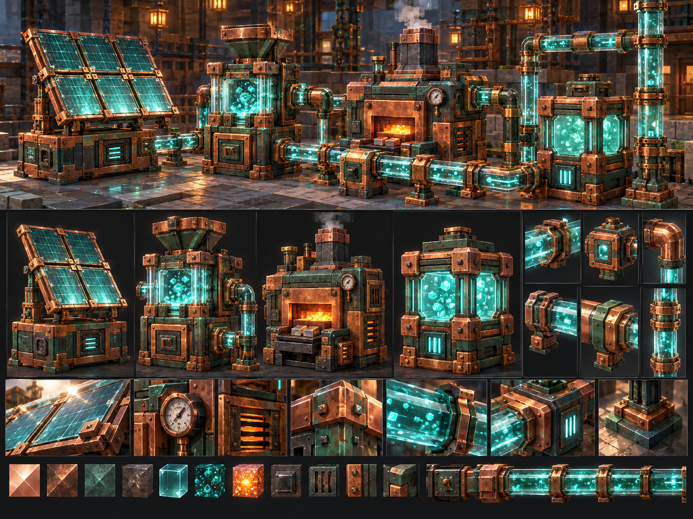

# Unusual Copper

**Текущая разработка:** **0.20.10-alpha.1**, экран настройки надетой брони и HUD; ещё не установлена. Установленная пара — **UC 0.20.9-alpha.1 + SSN Progressive 1.4.1** с оформлением промышленных устройств, компонентов и брони. [Настройка брони](docs/ARMOR_CONSOLE.md) · [Полный список оставшейся разработки](docs/COMPLETION_TRACKER.md). Кадры витрины подтверждают внешний вид в тестовом клиенте, а не функциональную приёмку всей фабрики.

Медная энергия, магические механизмы и автоматизация для **Minecraft Java 1.20.1 · Forge 47.x · Java 17**.

**Опубликованный релиз: 0.20.6-alpha.1.** Более новая промышленная 0.20.9-alpha.1 установлена локально. Проект находится в alpha: полная приёмка 1.0 ещё не завершена.

[Скачать 0.20.6-alpha.1](https://github.com/Gerbesh/unusual-copper/releases/tag/v0.20.6-alpha.1) · [Изменения](CHANGELOG.md) · [Руководства](docs/INDEX.md) · [Маршрут](docs/ROADMAP.md) · [Задачи](https://github.com/Gerbesh/unusual-copper/issues)



## Что умеет мод

| Система | Возможности |
|---|---|
| Медная энергия CuE | Солнечное насыщение → эссенция → энергия; три класса проводов и стационарных ячеек, приоритеты, разветвитель, монитор |
| Перенос энергии | Четыре батареи: 10 000 / 100 000 / 1 000 000 / 10 000 000 CuE, зарядка и разрядка через ячейки |
| Предметная логистика | Трубы с фильтрами, NBT/тегами, приоритетами, порогами запасов и визуальными маршрутами предметов |
| Производство и магия | Плавильня, каталог зелий автоклава, резонатор зачарований, починятор на CuE и опыте |
| Фермы | Культиватор с волной роста, сбором и пересадкой, магнитный коллектор, Пастырь роста, Жнец с выбором существ из области, Арборист |
| Добыча | Резонансный экстрактор: область до 128×128, настоящая кирка и её зачарования, модовые руды по тегам, заполнение места руды породой |
| Интеграции | Опциональные SSN Bridge, JEI, Open Parties and Claims; точные версии и границы проверки указаны в документации |

У экстрактора нет сплошного котлована: он выбирает руды и заменяет добытый блок подходящей породой. Полёт в сферу занимает 60 активных тиков, визуально сглаживается между кадрами. Обычная выгрузка предыдущего лута больше не останавливает другие полёты посреди пути. Расход добычи и поддержания поля снижен в четыре раза относительно 0.20.3.

## Установка

1. Установить Minecraft **1.20.1**, Forge **47.4.10+** и Java **17**.
2. Скачать `unusualcopper-0.20.6-alpha.1.jar` из [релиза](https://github.com/Gerbesh/unusual-copper/releases/tag/v0.20.6-alpha.1).
3. Закрыть клиент и остановить сервер, сохранить прежний JAR и заменить его в обеих папках `mods`. Оставить одну версию мода в каждой папке.
4. Для дополнительного SSN Bridge нужен **Simple Storage Network 1.13.2**. Если используется SSN Progressive, актуальная пара — **1.4.0**; его [отдельный репозиторий](https://github.com/Gerbesh/ssn-progressive) остаётся приватным. Без этих модов самостоятельные системы Unusual Copper доступны.

Контрольная сумма опубликованного JAR и сведения о проверках: [манифест 0.20.6](releases/0.20.6-alpha.1.json). Последняя совместная установка сверена с клиентом и сервером побайтно по SHA-256.

## Документация

**Промышленная разработка:** [Industrial Expansion E0–E9](docs/INDUSTRIAL_EXPANSION_ROADMAP.md) · [полный GDD](docs/INDUSTRIAL_EXPANSION_GDD.md) · [программируемая броня и полёт](docs/PROGRAMMABLE_ARMOR.md) · [инженерный TDD](docs/INDUSTRIAL_EXPANSION_TDD.md). Реализованные alpha-срезы и их ограничения описаны в [журнале промышленной реализации](docs/INDUSTRIAL_EXPANSION_IMPLEMENTATION.md) и [списке оставшейся разработки](docs/COMPLETION_TRACKER.md). Установленная 0.20.9 содержит промышленные устройства, но ещё не весь план E0–E9.

- [Экстрактор и сфера](docs/RESONANT_EXTRACTOR.md) — кирка, энергия, область, руды, очередь и визуальные эффекты.
- [Батареи](docs/BATTERIES.md), [предметные трубы](docs/ITEM_PIPES.md), [SSN Bridge](docs/SSN_BRIDGE.md).
- [Культиватор](docs/CULTIVATOR_HARVEST.md), [Жнец](docs/MOB_REAPER.md), [автоклав](docs/AETHERIC_BREWER.md), [починятор](docs/REPAIR_CRYSTAL.md).
- [Полный указатель](docs/INDEX.md), [архитектура](docs/ARCHITECTURE.md), [моделирование в Blockbench](docs/MODELING.md), [план и критерии 1.0](docs/ROADMAP.md).

## Сборка и проверки

```powershell
.\gradlew.bat --no-daemon build compileGameTestJava --console=plain
```

На Linux/macOS: `./gradlew --no-daemon build compileGameTestJava --console=plain`.

Результат: `build/libs/unusualcopper-<mod_version>.jar`, версия из `gradle.properties`. Команда выполняет JUnit и компилирует GameTest-сценарии; Minecraft и сервер не запускаются. Исторические проверки привязаны к версии в [отчётах](docs/verification/); их нельзя переносить на новые исходники. CI также собирает проект без запуска игры.

Обычный JAR не включает тестовые сцены, GameTest-классы и production probes. Внешний вид, совместимость в модпаке и нагрузочные показатели проверяются отдельно в игре; результаты прежних версий не подменяют проверку текущей сборки. [Как вносить изменения](CONTRIBUTING.md).

## Статус и права

Актуальная версия — alpha, не завершённый релиз 1.0. Планы M0–M5 и исходный концепт сохранены; наличие реализации не означает прохождение всей матрицы приёмки. Авторский код и ресурсы распространяются с прежним обозначением **All Rights Reserved**; лицензия этой публикацией не меняется.
