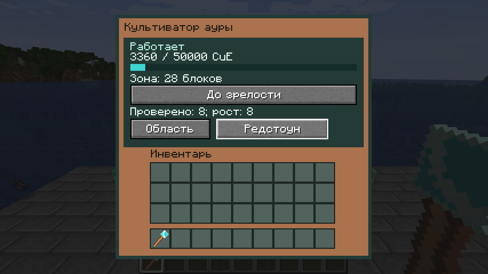
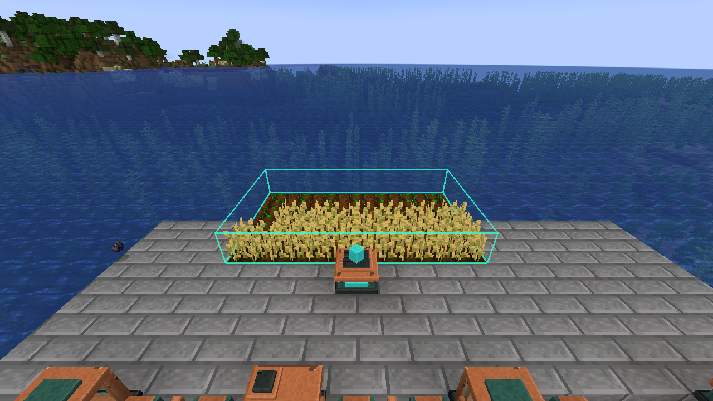

# Области, привязка хранилища и культиватор — 0.3

Проверено 15 октября 2026 года на Minecraft 1.20.1, Forge 47.4.10, Java 17. Это промежуточная alpha, а не завершение M2 или релиз 1.0. Исходный GDD v0.2 сохранён без изменений.

## Жезл

Shift + ПКМ по воздуху переключает три режима: область, хранилище, правила. Текущий режим указан в подсказке. Для области нажмите ПКМ по культиватору, затем выберите два угла. Выбираются сами координаты блоков растений, а не почвы. Меню машины позволяет повторно показать рамку. Предпросмотр видит только отправитель; зелёная рамка означает принятую область, красная — отказ. Рамка исчезает через 12 секунд.

Область включительная, до 16×16×16 и 4 096 координат. Все её углы должны находиться в пределах 32 блоков от машины, внутри высоты мира и world border. При выборе проверяются владелец, все затронутые чанки и права. Автоматика не загружает отсутствующие чанки. Смена измерения или замена выбранной машины требует выбрать её заново; незаконченный выбор также сбрасывается после перезапуска. Приватные координаты выбора не передаются в общий item share tag.

В режиме хранилища выберите машину с инвентарём, затем грань бочки, сундука или другого доступного `IItemHandler` в радиусе 32. Один раз в 20 тиков привязка переносит до восьми реальных предметов: сначала возвращает выходы, затем забирает подходящий вход. Частичный отказ остаётся во внутреннем сохраняемом грузе машины. Кнопка × отвязывает хранилище, сохраняя груз; ↓ возвращает доступный груз владельцу. При разрушении груз упаковывается в предмет восстановления. SSN Bridge этим механизмом ещё не реализован.

## Рост

Культиватор принимает CuE на разрешённых входных гранях, хранит 50 000 CuE и не имеет рабочих предметных слотов. По умолчанию запрашивает волну раз в 20 тиков. Волна проверяет до восьми координат, включая пустые и неподходящие. Общая FIFO-очередь ограничивает культиваторы 128 проверками на измерение за тик; при перегрузке волны откладываются. Конфиг `area_machines` позволяет снизить частоту/лимиты и изменить цену.

Успешное изменение растения стоит 140 CuE. Зрелое растение, сухая почва, недостаточное освещение, отмена Forge growth hook, запрет доступа и неподдержанный вид не оплачиваются. При запасе ниже полной цены растение не изменяется. Удобрение не расходуется; автоматического сбора урожая нет. Равномерный режим двигает курсор после операции; «До зрелости» повторяет доступный рост на текущей координате, оставаясь в лимите восьми проверок за волну. Область, курсор, режим и владелец сохраняются в NBT.

Явные адаптеры включают стандартные wheat/carrot/potato/beetroot, стебли тыквы/арбуза, sweet berry bush и cave vines. Проверяются применимые свет, почва и `canSurvive`. Стебель увеличивает только свой возраст и не создаёт плод за границей области. Кактус, тростник, деревья, грибы и неизвестные переопределения модов пропускаются: их многоблочные адаптеры ещё предстоят. Проверка пшеницы не означает приёмку всех видов и модовых растений.

## Проверки и границы

- `build` и 35 обязательных GameTests прошли; восемь JUnit-тестов проверяют расчёты и область, включая полные 4 096 координат, переполнение и копирование изменяемых позиций.
- Новые GameTests проверяют волну 8/16 растений за 1 120 CuE, паузы без оплаты, режим до зрелости, NBT, владельца/радиус/грани, очередь 20 машин, физическую привязку входа/выхода и отказ фактического приёма с однократным продолжением после NBT reload.
- На обычном dedicated server с настоящим OpenPAC 0.30.1 машина вне claim не смогла изменить чужую пшеницу внутри claim и сохранила 140 CuE. Владелец вырастил её одной операцией за 140 CuE. Отдельно подтверждена прежняя проверка прав инвентаря.
- Настоящий клиент: серверный `useOn` жезла выбрал 28 координат и открыл меню; кнопка режима прошла через обычное меню, видны состояние и рамка. Это проверка серверного пути и отображения, а не автоматизация пользовательских кликов мышью. Скриншоты ниже.

Свидетельства: [выдержки логов](verification/area-cultivation-2026-10-15.txt). Повторить базовые проверки: `gradlew.bat --no-daemon build runGameTestServer`; OpenPAC использует изолированный профиль, описанный в [ITEM_TRANSPORT](ITEM_TRANSPORT.md). Нужны обе строки `CuE OPENPAC CLAIM PASS` и `CuE OPENPAC CULTIVATOR PASS`.

Ещё требуются отдельные выгрузки/загрузки чанков в живой игре, матрица остальных видов/провайдеров, проверка Forge 47.4.20 и профилирование. NBT reload не заменяет дисковый restart или аварийное отключение. Гарантии межчанковой crash-атомарности переноса остаются открытым D11; описание в [ITEM_TRANSPORT](ITEM_TRANSPORT.md) относится и к привязке.

