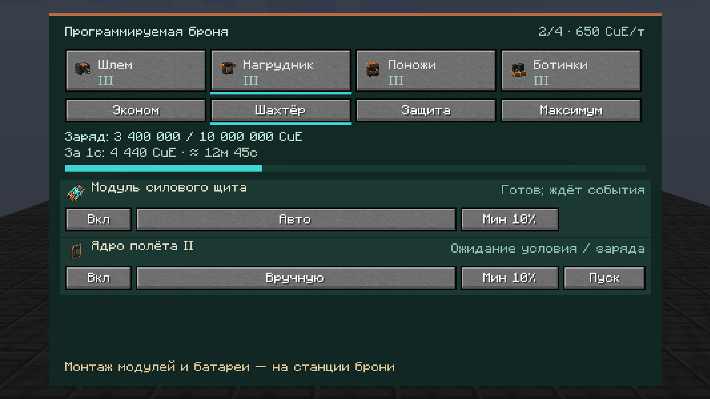

# Настройка надетой брони и HUD — 0.20.10-alpha.1

Это реализованный этап E6 поверх промышленной 0.20.9. Он не завершает весь контракт [программируемой брони](PROGRAMMABLE_ARMOR.md). В клиенте и на сервере пользователя пока установлена 0.20.9; эта сборка туда автоматически не переносится.

## Управление

- **K** — открыть настройки надетой брони; Escape закрывает экран. Четыре карточки выбирают шлем, нагрудник, поножи и ботинки.
- **V** — следующий профиль. Эконом / Шахтёр / Защита / Максимум имеют независимые сохраняемые настройки. Профиль сам не открывает способности и не устанавливает модули.
- **H** — показать/скрыть HUD; выбор сохраняется в клиентском конфиге. Клавиши переназначаются в стандартном меню Minecraft.

В строке модуля доступны включение, условие, минимальный процент заряда и «Пуск/Стоп» для ручного условия. Нажатие меняет условие вперёд, Shift-нажатие — назад; порог меняется по 5%. Ручное взведение разрешает модулю работать, но не отменяет его естественные условия: прыжок всё ещё требует прыжка, парение — приседания в воздухе, F3 — спринта в воздухе. Физический монтаж и снятие модулей/батареи остаются на станции брони.

Условия вычисляет сервер: под водой; в воздухе; в огне; бой в последние 100 тиков; здоровье ниже 40%; добыча в последние 10 тиков; ручное взведение. Краткие боевые/горные флаги не сохраняются между сессиями. Не настроенные ранее строки сохраняют поведение прежних четырёх профилей.

Порог заряда — условие допуска перед оплатой, а **не защищённый остаток энергии**. Полёт F4 и его резерв 120 000 CuE ещё не реализованы; UI не выдаёт их за готовую функцию. Визор пока явно показывает «Эффект недоступен».

## Показания

Экран и HUD показывают физическую батарею нагрудника, заряд, расход за последние **20 серверных тиков** и иконки модулей, за которые действительно списана энергия. Событийные расходы прыжка, щита и падения включены в этот счётчик. Прогноз времени приблизителен: он верен лишь при сохранении показанного расхода; разовые события быстро меняют прогноз. При низком TPS интервал 20 тиков длиннее одной реальной секунды.

При переходе ниже 25/10/5% появляется сообщение в строке действий, даже если HUD скрыт. Неполный комплект одного уровня показан отдельно. Старый HUD скрывается при отсутствии обновлений более 60 клиентских тиков; переход в другой мир очищает клиентский снимок.

## Данные и серверная граница

`ArmorData` хранит добавочный `Presets/0..3/<module ID>` в собственном NBT физической части брони. Там только Enabled, Trigger, Minimum, Armed. Батарея, зачарования и прочий NBT не переписываются настройками. Неподдерживаемые или повреждённые настройки не активируют способность.

`ArmorControlServer` работает в серверном потоке, адресует снимки только владельцу и проверяет живого отправителя, актуальную сессию/ревизию, физические надетые предметы, установленный модуль и диапазоны значений. В запросе нет чужого UUID, ItemStack, NBT, цены или энергии. Замена экипировки/конфигурации обновляет сессию; опоздавшее намерение отклоняется с возвратом свежего снимка. Клиент ждёт подтверждения и не применяет настройку к предмету самостоятельно. Периодический снимок отправляется дважды за 20 серверных тиков.

## Проверка и оставшаяся работа

JUnit проверяет допускающие условия, пороги/ручное взведение, срок жизни счётчика, ревизии и границы команд, bounded codec снимка. Сценарии сохранения реальных ItemStack и отклонения повреждённого NBT добавлены в `ArmorConfigurationGameTests`, но **только скомпилированы**. Функциональный игровой запуск остаётся за пользователем.

Сборка прошла **119 JUnit без ошибок** и `compileGameTestJava`. В обычном JAR проверены локализации RU/EN, наличие новых классов, refmap и отсутствие тестовых сцен; [отчёт с SHA-256 и хешами кадров](verification/armor-console-2026-10-17.json).

Снимки GUI/HUD получены отдельно разрешённой визуальной витриной в собственном скопированном тестовом мире. Данные GUI синтетические; витрина не надевает работающий комплект на игрока, не отправляет команды настройки и не доказывает применение способностей или сохранение. Проверяются русская компоновка 1600×900 и 1280×720, страницы и HUD. Исходные 11 кадров художественного этапа 0.20.9 и их отчёт сохранены отдельно.

До полной E6 остаются редактируемые приоритеты, единое списание и арбитраж лимитов 150/650/150/200 и 900 CuE/тик, другие модули/уровни, полноценный визор/сканер, конфликты эффектов и игровая приёмка. F4/резерв/аварийная посадка относятся к E7 и также остаются в [общем трекере](COMPLETION_TRACKER.md).
