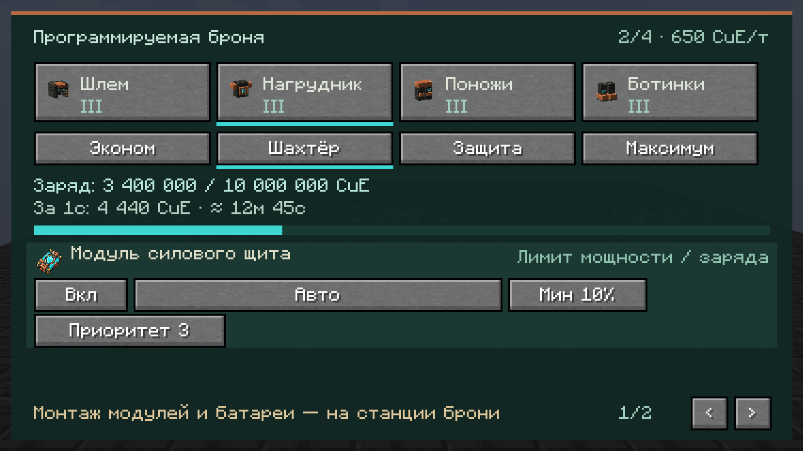

# E6C: сохраняемый расчёт платежей брони — 0.20.11-alpha.1

База `514617a`: GUI, приоритеты по профилю, HUD F3 и арбитраж непрерывных расходов уже существуют. Этот этап объединяет оплату со щитом, падением, прыжком и горным сервоприводом. Он не заменяет полную приёмку E6/E7 и не добавляет F4.

## Энергия до эффекта

`BatteryChargeLedger` хранит в **той же физической батарее** целочисленный `UCReservedCuE`, ограниченный диапазоном 0..CuE, и UUID партии `UCReservationBatch`. Доступный запас равен `CuE − UCReservedCuE`. До применения эффекта сервер увеличивает этот резерв; больше потратить зарезервированную часть нельзя. Возврат/расчёт привязан к UUID: квитанция прежней партии не освобождает резерв заменённой батареи или новой партии. Отдельного энергетического баланса на игроке нет.

В конце серверного тика `ArmorPayments` проверяет результат событий, освобождает отменённые резервы и один раз сворачивает оставшуюся сумму в поле CuE каждой затронутой батареи. Повторная свёртка ничего не списывает. Периодические снимки владельцу идут после расчёта; инвентарь синхронизируется один раз на пакет платежей. Неприменённая часть непрерывного плана освобождается и при исключении во время применения эффектов.

NBT с резервом самодостаточен: после обычного сохранения/восстановления или снятия батареи доступен тот же остаток. Следующее изменение заряда через `CopperBatteryItem.stored(stack, value)` сворачивает прежнюю обязанность; зарядка/разрядка считают цену от доступного остатка. При отсутствии дальнейших операций резерв может оставаться в NBT, но не возвращается в доступный запас. Пустая батарея после нормализации сохраняет обычный вид без CuE:0; чужие теги не стираются. Повреждённый резерв блокирует работу комплекта.

Это **платёжный резерв разрешённых расходов**, не аварийный остаток F4 120 000 CuE. Аварийная посадка остаётся отдельной незавершённой задачей E7.

Канал брони использует протокол **4**: клиент тоже должен понимать доступный остаток батареи с этим NBT. Нужны одинаковые новые версии клиента и сервера; старый интерфейс не подключается с неверной трактовкой заряда.

## События и мощность

- Один и тот же объект Forge-события не получает повторную авторизацию. Для прыжка остаётся cooldown 40 тиков. Щит оплачивается только в LivingDamageEvent, а не параллельно в LivingHurtEvent.
- Щит, падение и добыча обрабатываются на LOWEST; в конце тика проверяется поздняя отмена. Отменённый резерв не попадает в показанный оплаченный расход. Изменённый другим обработчиком множитель падения и скорость добычи учитываются при подтверждении.
- Запросы BreakSpeed одного игрока за серверный тик делят одну оплату **8 CuE**; повтор того же запроса не умножает ускорение. Если все запросы отменены/не дали ускорения, резерв освобождается. Замена физической части брони, профиля или настроек не позволяет переиспользовать старую авторизацию.
- Горный сервопривод занимает мощность поножей и комплекта. Позже планируемые непрерывные расходы учитывают занятые квоты; деньги за эту работу второй раз не списываются. В плане сохраняется цена каждого принятого запроса, включая будущие уровни модулей.
- Разовые цены прыжка/щита/удара оплачиваются отдельно от лимита непрерывной мощности 900 CuE/тик, но входят в общий итог. Они авторизуются в момент события; приоритеты 2–6 ранжируют непрерывные заявки, а не переписывают уже случившийся урон. На игрока допускается максимум 64 новых событийных платежа за тик; очередь горных запросов также ограничена 64.

## Проверка и границы

JUnit проверяет совмещение резервов, точный остаток, отказ перерасхода, освобождение отменённой части, бинарный NBT round-trip, зарядку/разрядку, повреждённый NBT, принадлежность квитанции и занятые квоты планировщика. Отдельно проверяются повторное/вложенное событие, повтор после отказа оплаты и ограничение очереди. В `ArmorConfigurationGameTests` добавлены снятие/сохранение реальной батареи и итог с чужими тегами. `ArmorPaymentGameTests` содержит повтор прыжка, позднюю отмену урона и повторные запросы скорости. Игровые сценарии **только скомпилированы**; исполнение и проверка в модпаке остаются за пользователем.

Визуальная витрина отдельно показывает приоритеты, отказ по мощности, активный и истёкший F3 на **синтетическом снимке** владельца. Она не отправляет команды настройки, не надевает работающую броню и не проверяет платежи в игре. Исторические кадры 0.20.9/0.20.10 сохранены отдельно.

Итог сборки: **137 JUnit без ошибок**, GameTests скомпилированы, 10 кадров RU 1280×720 / EN 1600×900 сохранены. Проверены обычный JAR, refmap, исключение тестовых классов, паритет локализаций и неизменность старых кадров. [Отчёт с SHA-256](verification/armor-payments-2026-10-18.json).

Граница совместимости: отмену можно вернуть, пока резерв остаётся в нашем физическом предмете. Если чужой мод раньше переписал/переместил вложенную батарею вне протокола, создавать возмещение без доказанного владения нельзя. Произвольные копии мира/предметов и откат на старый JAR, который не понимает новый резерв, не являются транзакциями этого протокола. Crash-атомарность между несколькими файлами мира не обещается. Широкая совместимость, реальные отмены/смерть/перенос/SMP, нагрузка и F4 ещё требуют приёмки.
