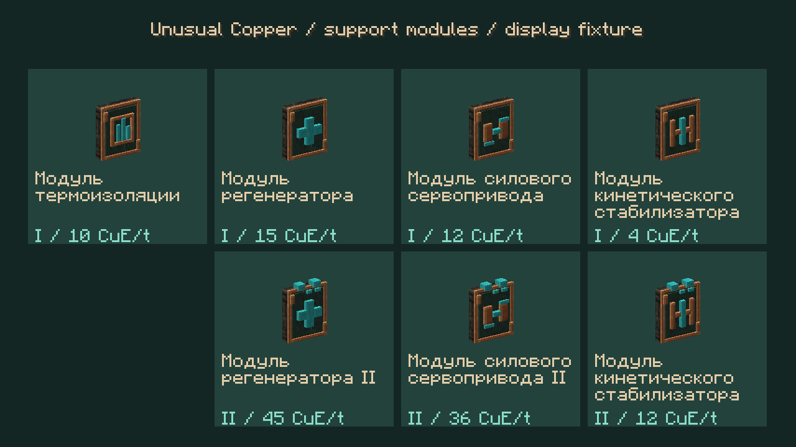
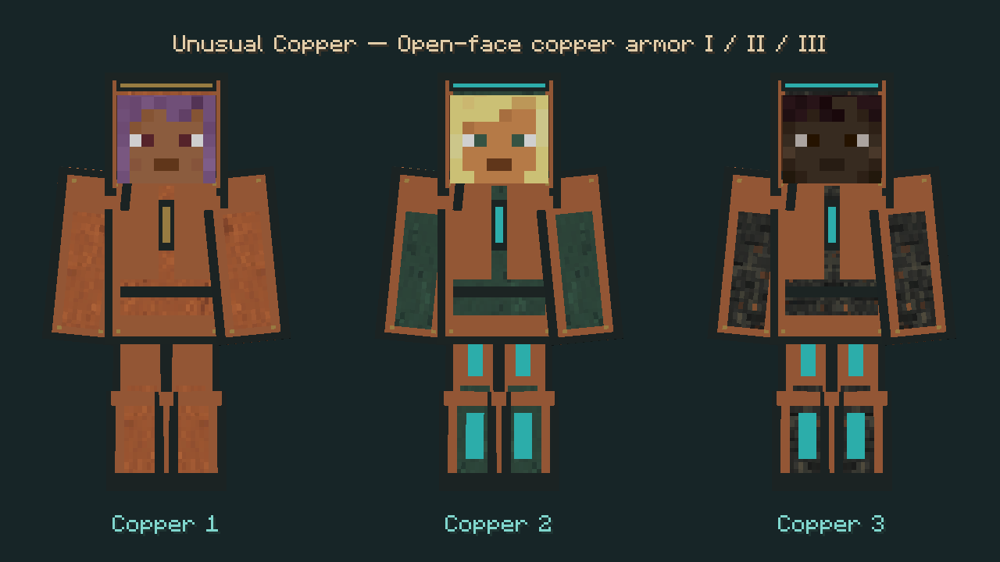

# E6F: поддержка и силовые модули — 0.20.14-alpha.1

Кандидат поверх `b76fef1`; **не установлен**. Продолжает [визор и анализатор](ARMOR_SENSES.md). Полный [маршрут разработки](COMPLETION_TRACKER.md), мультиблочные баки 16 000 мБ/блок и игровая приёмка остаются открытыми.

## Использование

Поставить физические картриджи на верстаке брони, надеть полный комплект одного уровня и установить батарею в нагрудник. В K выбрать профиль «Защита» или включить модули вручную. У каждого действуют собственные условия, порог заряда, приоритет и общий лимит питания. Четыре модуля нагрудника занимают все четыре гнезда шасси III: одновременно поставить туда ещё и полёт нельзя.

| Модуль | Место / уровни | Действие по умолчанию | Оплата |
|---|---|---|---|
| Термоизоляция | Нагрудник / I | Предотвращает огненный урон, включая лаву, кроме типов с обходом неуязвимости/сопротивления | 10 CuE/тик при огне/лаве или реальном огненном ударе |
| Регенератор | Нагрудник / I–II | До 1/2 HP за попытку каждые 40 тиков, пока ранен | 15/45 CuE/тик + 500 за реально восстановленный HP |
| Силовой сервопривод | Нагрудник / I–II | До +2/+4 HP прямому удару; учитывает перезарядку атаки, собственная прибавка не поднимает общий урон выше 30 HP | 12/36 CuE за тик с применённым усилением |
| Кинетический стабилизатор | Поножи / I–II | +0,25/+0,5 сопротивления отбрасыванию, общая величина не выше 1 | 4/12 CuE/тик, пока есть полезная прибавка |

Силовой привод не усиливает снаряды, вторичные цели sweep-удара и произвольный урон без реальной атаки по той же цели в том же тике. Уже более сильный чужой удар не ослабляется. Добавка масштабируется перезарядкой; ванильный критический урон не пересчитывается. Прибавка в PvP по умолчанию отключена; запрет не отменяет базовую атаку. Перед усилением проверяется разрешение claims для цели.

Регенератор не выдаёт зелье. При внешней регенерации приостанавливается; при полном HP не платит. Он вызывает стандартный Forge-хук лечения один раз и после сторонних обработчиков заново считает собственную прибавку от нового здоровья. Отмена или стороннее лечение возвращают неиспользованную событийную оплату. Минимальная пауза действует и после отменённой попытки. Постоянное питание раненого включённого ядра оплачивается отдельно.

Термоизоляция не создаёт эффект огнестойкости. Если внешнее зелье уже предотвращает урон, дублирующее питание не нужно. Стабилизатор меняет только свой временный модификатор; чужие модификаторы сохраняются, собственный снимается при разукомплектовании/выходе.

## Питание, конфиг и совместимость

`serverconfig/unusualcopper-armor-effects.toml` задаёт цены каждого уровня всех модулей, цену лечения, интервал попыток и разрешение силового привода в PvP. Цены не обходят ограничения шлейфа 150/650/150/200 и 900 CuE/тик на комплект. Старые значения сохранены по умолчанию. Взвод прыжка и настройки прочих событийных цен ещё предстоит закончить.

Раннее событие и обычный тик используют одну авторизацию питания модуля. Весь непрерывный план публикуется до запуска эффектов, поэтому вложенный хук видит уже занятый шлейф. Не начатые действия возвращают резерв; действие, начавшееся и завершившееся исключением, сохраняет оплату консервативно. Отменённые реактивные события возвращают свой резерв, если модуль не использовал его для непрерывной работы.

Новые типы добавлены в конец списка, старые ID/уровни/данные сохранены. Формат канала `armor_control` — **7**, клиент и сервер должны совпадать. Эффект тела передаёт только измерение, ID наблюдаемого игрока, тип и уровень; здоровье, батарея, настройки и инвентарь в пакет не входят.

## Визуал

Семь отдельных редактируемых моделей картриджей: тепловой экран, крест регенератора, поршень и стабилизатор. У II уровня выступающие парные контакты, заметные в инвентаре. Статические рецепты используют физический предыдущий картридж; SSN видит обычный результат.

После подтверждённого срабатывания показывается короткий импульс вокруг корпуса: бирюзовый восходящий для лечения, янтарный для огня и медный расширяющийся для удара. Время — плавные 0,85 секунды от клиентских часов; положение носителя интерполируется между кадрами. Импульс не закрывает лицо, не рисуется перед глазами от первого лица, учитывает глубину и настройку частиц. F1 скрывает интерфейс, сохраняя эффект в мире. Максимум 64 импульса на клиенте, радиус отображения 48 блоков; повторный огонь не создаёт неограниченную очередь.

HUD размещает активные картриджи во второй строке при заполнении первой. Подсказки предметов и строк консоли объясняют поведение на RU/EN.

## Границы проверки

`build` и `compileGameTestJava` прошли; **168 JUnit**, 202 модели и 23 авторских прозрачных спрайта проверены. Сохранены **30 кадров**: RU 1280×720, EN 1600×900 и EN с Oculus/Xenon + Complementary Reimagined r5.8.1. [Отчёт с SHA-256](verification/armor-support-2026-10-18.json) связывает исходники, JAR и кадры; предыдущие архивные сборки/изображения проверены без изменений. Better MC — Medium по-прежнему имеет неразобранный GLSL-сбой из предыдущего этапа, его поддержка здесь не подтверждается.

Сборка, JUnit, генерация рецептов и компиляция GameTest-сценариев выполняются отдельно от визуального профиля. Витрина использует демонстрационные пакеты и клиентский манекен без рабочих модулей/батареи; скриншоты подтверждают только отображение. Игровые сценарии раннего огня и дробного лечения добавлены для последующей приёмки, но не запускались. Полная Better MC, PvP/claims, отмены сторонних модов, миграция/SMP и MSPT остаются непроверенными.
