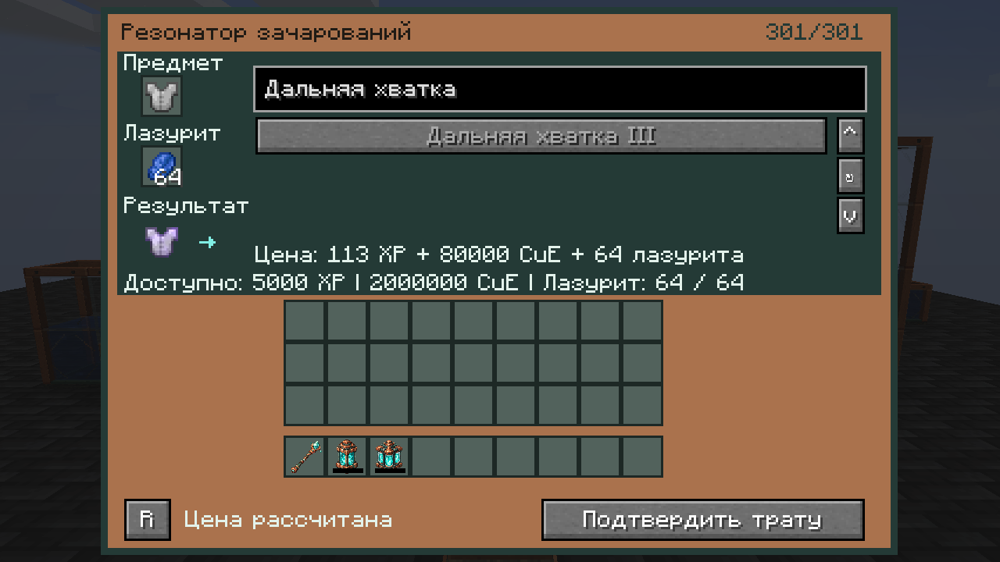
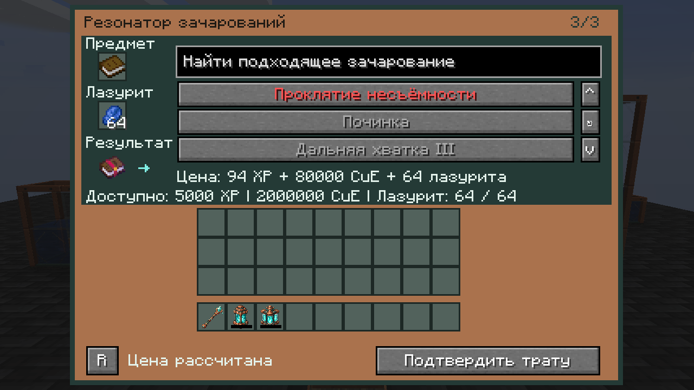

# Модовая одежда и зачарования — 0.20.16-alpha.1

Кандидат поверх `94af312`; пока установлен UC **0.20.15-alpha.1** / SSN **1.4.1**. Зачарователь больше не ограничивает модовые предметы и чары ручными списками ID. Полный маршрут разработки остаётся в [трекере](COMPLETION_TRACKER.md).

## Применимость

По умолчанию используется весь реестр `ForgeRegistries.ENCHANTMENTS`, включая модовые, сокровищные, недоступные обычному столу по `isDiscoverable`, и проклятия. Для одежды, аксессуаров Curios, инструментов и других зарегистрированных предметов окончательное решение принимает **`Enchantment.canEnchant(ItemStack)`**. В Forge 1.20.1 стандартная реализация вызывает `canApplyAtEnchantingTable` предмета; переопределения самого зачарования также сохраняют силу. Проверки `instanceof ArmorItem`, ванильного namespace и положительной enchantability для допуска предмета в слот больше нет.

Поэтому модовая одежда без ванильного класса брони и даже с нулевой enchantability может получить разрешённые её модом чары. Любой зарегистрированный предмет можно положить в слот; неподходящий предмет показывает отсутствие совместимых вариантов и ничего не оплачивает. Не каждое зачарование применяется к каждой вещи: родные ограничения, несовместимость в обе стороны и максимальный уровень сохраняются.

Уже имеющиеся чары учитываются и из обычного NBT, и из Forge `getAllEnchantments`: скрытый/встроенный модовый эффект нельзя продать повторно или обойти при проверке конфликтов. Результат остаётся копией исходного предмета с сохранением его типа, имени, износа, постороннего NBT и сериализованных capabilities. Меняется стандартная запись выбранных чар; существующие дополнительные поля этой записи сохраняются.

До выдачи предложения проверяется обратное чтение результата через Forge. Если предмет разрешает чары по применимости, но игнорирует стандартную запись и не показывает полученный уровень, он не получает оплачиваемое предложение. Нужен его специализированный адаптер; за неработающий результат ресурсы не списываются.

Обычные и зачарованные ванильные книги используют прежний адаптер. Специальные системы магии, не регистрирующие `Enchantment` или не использующие стандартные Forge-контракты записи/чтения, требуют собственного адаптера. Например, повышение уровня древним томом Quark — отдельная механика предмета, а не новое зарегистрированное зачарование. Эта работа не превращает любой магический предмет в обычную зачарованную книгу и не обходит запреты его мода.

## Серверные настройки

Группа `[enchanter]` в `unusualcopper-server.toml`:

```toml
automatic_mod_compatibility = true
allow_treasure = true
allow_curses = true
maximum_level = 32767
```

Это новые значения по умолчанию. Уже существующий TOML сохраняет прежние `allow_treasure`, `allow_curses` и `maximum_level`: обновление JAR само по себе не переписывает выбор администратора. На обследованном сервере Better MC оба разрешения выключены, а предел равен 255; для запроса пользователя нужно обновить эти четыре параметра после штатной остановки, сохранив прежний файл. В multiplayer действует конфигурация мира **сервера**, не локальный клиентский файл.

`automatic_mod_compatibility = false` возвращает старый режим с `allowed_mod_items` и `allowed_mod_enchantments`. Сокровищные чары и проклятия можно независимо отключать. Реальный уровень всегда ограничен `getMaxLevel()` самого зачарования; 32767 — предел стандартной short-записи, а не искусственное повышение выше максимума мода. Прежние формулы цены и физический буфер 2 000 000 CuE сохраняются: непредставимая цена или цена выше буфера не выдаётся как оплачиваемое предложение.

## Каталог и подтверждение

Прежний каталог полностью исчезал при более чем 256 подходящих чарах. Теперь полный серверный список передаётся страницами **до 64 записей и 64 КиБ**, с общим числом, идентичностью текущего предмета/конфигурации и последовательными смещениями. У общего каталога нет прежнего лимита 256; размер ограничен реальным синхронизированным реестром. Длинные допустимые ID уменьшают число записей в странице, а не исключаются из каталога.

Первый пакет сразу показывает начальные варианты. Последующие страницы идут не чаще одного раза за тик открытого меню; поиск по ID и локализованному названию охватывает полученные страницы и продолжает находить новые по мере загрузки. Счётчик `64/301` и статус загрузки не дают принять ещё не загруженный каталог за завершённый. Запоздавшая страница другого предмета отбрасывается, а очередной снимок XP/CuE не стирает полученные страницы.

Каталог пересчитывается при замене/изменении полного отпечатка входа, его ревизии, серверных правил или размера реестра. Изменение запасов энергии/опыта обновляет только статус. Кнопка ↻ выполняет принудительное обновление для нестандартных динамических правил мода; запросы ограничены одним в 20 тиков. Клиент не сообщает серверу применимость, цены, результат или собственный NBT.

Выбор и подтверждение по-прежнему отдельно пересчитывают применимость и цену на сервере. Истечение цены, смена вещи/прав/ресурсов и повтор nonce не дают оплатить старый результат. Соблюдение native-хуков означает широкую общую совместимость; оно не является доказательством корректности произвольного стороннего обработчика или полной игровой приёмки Better MC.

## Свидетельства

- Статически проверены установленные JAR Aether, Deep Aether и Quark: перчатки Aether наследуют `AccessoryItem`, где есть собственный Forge-хук; `GlovesReachEnchantment` Deep Aether имеет `isTreasureOnly = true`, `isDiscoverable = false`, максимум III. Сопоставление SRG-имён сделано по локальным mapping-файлам. Это чтение байткода, не игровой тест всей сборки.
- JUnit проверяет сборку 4 097 вариантов, старые страницы после замены вещи, повторные заголовки, размер реестра, пакеты, длинные ID/байтовые страницы и значения конфигурации.
- Четыре новых игровых сценария одежды с нулевой enchantability, встроенного проклятия, каталога более 300 чар и предмета, игнорирующего стандартную запись, **скомпилированы, не запускались**. Их отдельные тестовые предметы/чары находятся в `uc_enchanter_fixture` и не входят в обычный JAR; сценарии предполагают разрешённые автоматическую совместимость и сокровищные чары.
- Сохранены 12 экранных кадров: native EN 1600×900 и RU 1280×720. Витрина использует заданные клиентские страницы/цены/копии предпросмотра, не отправляет выбор или подтверждение и не списывает ресурсы. Она не доказывает выполнение реальной операции на сервере.





Полная Better MC, paid-flow сторонних предметов, SMP, save/reload и нагрузка остаются за игровой приёмкой. [Исторический контракт и цена](ENCHANTMENT_RESONATOR.md). [Манифест проверки кандидата](verification/enchanter-compat-2026-10-18.json).
