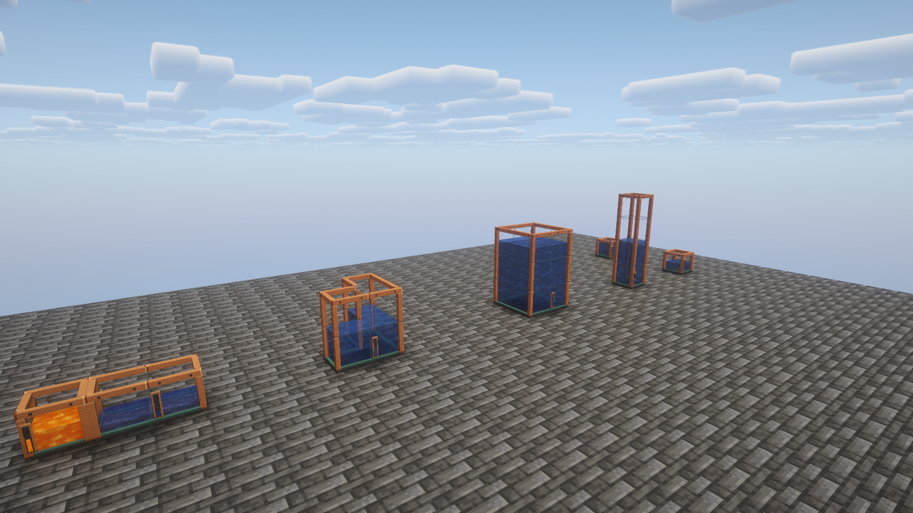
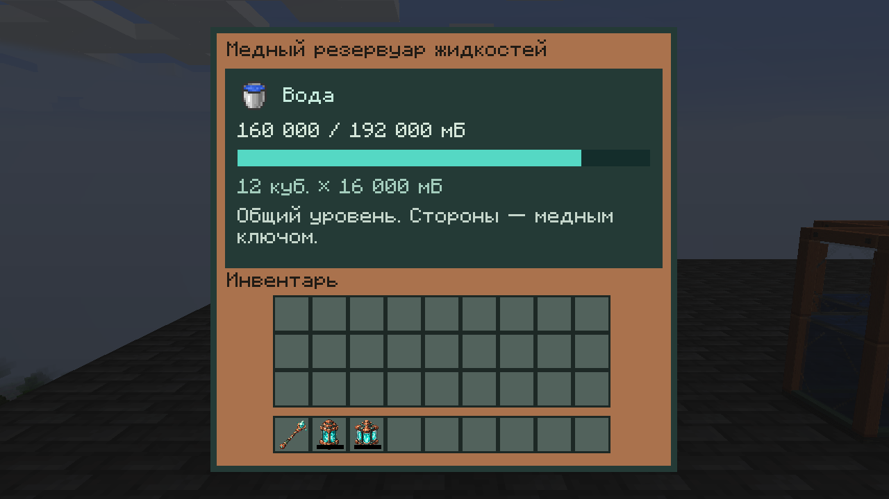

# Медные жидкостные мультиблоки — 0.20.15-alpha.1

Кандидат поверх `21fff98`; **установлен в клиент и сервер 18 октября 2026**. [Контрольные суммы и резервные копии](verification/install-0.20.15-2026-10-18.json). Соседние медные резервуары теперь образуют общее хранилище с ёмкостью **16 000 мБ на куб**. Это продолжение полного [маршрута разработки](COMPLETION_TRACKER.md), а не объявление завершённого релиза.

## Как пользоваться

Поставить баки вплотную гранями. Колонны, прямоугольники и ступенчатые/L-образные формы поддерживаются. У объединяемых блоков должен совпадать владелец. Жидкости и их NBT не смешиваются: пустые кубы присоединяются к ближайшему заполненному источнику; при одинаковом расстоянии порядок выбора постоянный.

| Кубов | Номинальная ёмкость |
|---:|---:|
| 1 | 16 000 мБ |
| 8 | 128 000 мБ |
| 12 | 192 000 мБ |
| 256 | 4 096 000 мБ |

Вёдра и трубы обращаются к одному общему хранилищу. Вводить/забирать жидкость можно через любой доступный куб; автоматические стороны настраиваются медным ключом. По умолчанию низ — выход, остальные грани — вход. Настройки сторон управляют трубами; ручное ведро требует доступа игрока и разрешения территории. Питание CuE не требуется.

Операция ведром выполняется только целиком, на 1 000 мБ. Если свободен лишь остаток меньше ведра, резервуар и предмет остаются нетронутыми. Поддерживаются обычные и Forge-совместимые модовые вёдра; если у жидкости нет ведра, используется труба. Нативный звук выбирается через тип жидкости.

Лимит — 256 соприкасающихся кубов одного владельца в загруженном компоненте, включая соседние секции разных жидкостей. При превышении они временно работают как одиночные баки и показывают причину в интерфейсе. Между большими независимыми хранилищами можно оставить зазор.

## Старые баки и разборка

Содержимое прежнего бака на 64 000 мБ **не обрезается**. Он показывает, например, `64 000 / 16 000 мБ` и предупреждение о старом запасе. Новую жидкость можно добавить после выгрузки избытка либо присоединения достаточного числа новых кубов. Даже если физическая локальная порция ещё превышает 16 000 мБ, общий приток никогда не превышает новую номинальную ёмкость.

Каждый куб сохраняет свою реальную порцию в прежнем `WaterTank` NBT. Общая сумма вычисляется из этих порций; при соединении не создаётся копия общего запаса и не происходит скрытого перераспределения жидкости между файлами чанков. Версия общего NBT машины остаётся прежней: структура записи жидкости не изменена.

При обычном разрушении предмет снятого бака несёт **только его локальную порцию**, остальные кубы сохраняют свои. Эта порция может отличаться от визуальной доли куба: уровень у группы общий, физический учёт распределён. При установке жидкость возвращается из NBT предмета. Если таблица добычи выдаёт несколько копий блока, жидкость переносится только в один предмет; другие копии пусты. Полное ведро и содержимое снятого блока не являются вторым источником той же жидкости. Creative-удаление без добычи и намеренная таблица добычи без предмета бака уничтожают содержимое удаляемого куба обычным для удаления ресурсов способом.

## Загрузка и защита

Учитываются только уже загруженные части. Выгруженные кубы сохраняют жидкость в своих чанках; доступная загруженная часть может временно стать отдельным хранилищем. При обратной загрузке части объединяются снова. Сам мод чанки не загружает. Разные владельцы не объединяются; перед переносом повторно проверяются актуальные ссылки на блоки и доступ территории. Неизвестный/ошибочный провайдер защиты не даёт разрешение автоматически.

На выгрузке старые Forge capabilities инвалидируются; повторная загрузка выдаёт новый экземпляр и новую идентичность визуального состояния. Ссылку на снятый/выгруженный резервуар нельзя использовать для продолжения переноса.

## Внешний вид и интерфейс

У кубов цельная медная обвязка с крепежом, тёмное основание и стекло. Внутренние стенки и стыковые крышки убраны. Уровень — одна общая горизонтальная плоскость, включая ступенчатые формы; поддержка углов учитывает вогнутые участки. У сборки один визуальный уровнемер, ориентированный по внешней грани главного куба.

Плоскость и уровнемер плавно подходят к новому состоянию по клиентским часам, независимо от FPS. Запоздавший снимок другого куба не отматывает анимацию назад. Изменения количества передаются через одного представителя на чанк, затем обновляют общий клиентский кэш даже у кубов вне кадра. Геометрические изменения передаются отдельно. Общий бюджет — 64 уведомления блоков за серверный тик с очередностью между измерениями; это ограничение работы, не измерение MSPT.

Интерфейс показывает общий объём, ёмкость и число кубов через полные 32-битные значения. При открытии запрашиваемый куб получает свежий снимок; последующие обновления других представителей обновляют и открытый экран. Предмет наполненного бака отображает настоящую жидкость внутри, в том числе у старого переполненного бака. Blockbench-исходник сохраняет полную одиночную раму; общий рендер размещённого/переносимого бака использует те же материалы.

Для зарегистрированных модовых жидкостей сохраняется исходный NBT и используются нативные текстуры типа жидкости. Публичный мировой снимок не передаёт приватные теги жидкости: нестандартная окраска/название, зависящие только от таких тегов, в мировой модели могут отличаться от предмета. Совместимость конкретных модов требует отдельной проверки.

## Проверка

JUnit покрывает детерминированное разделение, форму уровня, сохранение старого переполненного объёма, 10 000 случайных переносов, границы визуального снимка, углы и интерполяцию при разных FPS/старых ревизиях. Игровые сценарии целого ведра, смешивания NBT/владельцев, разборки/восстановления и устаревших capability скомпилированы, **не запускались**.

Сборка и `compileGameTestJava` пройдены; **177 JUnit без ошибок**, статическая проверка 202 моделей и 23 прозрачных авторских спрайтов. Сохранены 30 кадров: native EN 1600×900, native RU 1280×720 и Oculus/Xenon + Complementary Reimagined r5.8.1 EN 1600×900. [Манифест кандидата и контрольные суммы](verification/fluid-tanks-2026-10-18.json). Это изолированный стенд, не полная Better MC. Ранее полученная GLSL-ошибка пресета Better MC Medium не считается исправленной этим просмотром.

Визуальная витрина использует заданные количества жидкости и клиентские экраны в отдельном тестовом мире. Это проверка моделей, снимков и отображения, не приёмка реального переноса, добычи, вёдер, claims или произвольных аварийных завершений. Обычное сохранение локальных порций не доказывает атомарность межчанкового переноса при аварии между разными записями на диск. Полные SMP, save/reload/аварии, целевая Better MC и p95/добавка мода остаются в общем плане приёмки.
