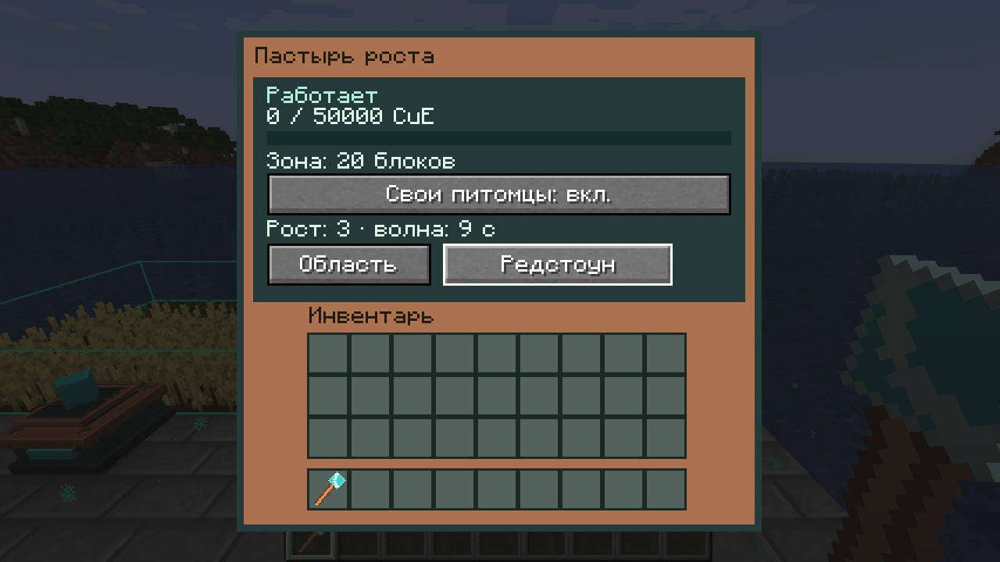
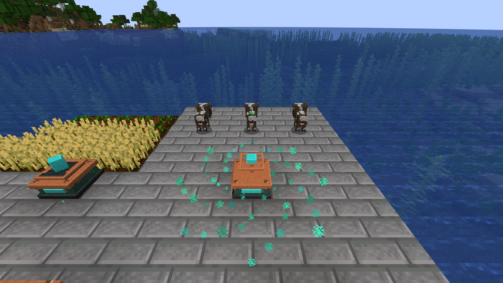

# Пастырь роста — 0.4.0-alpha.1

Машина M3 из раздела 9 исходного GDD. Выделите область жезлом и подведите CuE. До 16 кандидатов за волну; каждая действительно ускоренная особь стоит 400 CuE и получает до 2 400 тиков взросления. Следующая волна разрешается через 200 мировых тиков после выполнения предыдущей. Это настройки `area_machines.shepherd_*` с исходными значениями GDD.

Машина хранит 50 000 CuE. Все грани изначально принимают энергию; селектор переключает их между входом CuE и отключением. Рабочего инвентаря нет. Еда не создаётся и не расходуется. Положительный возраст — cooldown родителя — не изменяется; `InLove`, еда и размножение не затрагиваются. Последняя операция может довести отрицательный возраст до нуля, сохранив нормальный переход во взрослое состояние через API сущности.

## Управление и права

Область включительная, до 16×16×16, со всеми углами в радиусе 32. При выборе проверяются мир, загруженные чанки и владелец; перед каждой операцией заново проверяются машина и цель. Автоматика не подгружает чанки. Redstone приостанавливает работу.

Кнопка «Свои питомцы» по умолчанию выключена. Включение допускает только животное с UUID владельца машины. Чужие питомцы остаются исключёнными. Учтены обе ванильные модели владения: `TamableAnimal` и `AbstractHorse`. Особенность Camel: ванильный `isTamed()` всегда возвращает true, поэтому верблюд без UUID владельца считается обычным животным; имеющаяся метка владельца всё равно защищается.

Игроки не включены в индекс мобов. Жители/странствующие торговцы и типы из `forge:bosses` исключаются независимо от адаптера. Неизвестные виды и неизвестные реализации пропускаются с диагностическим статусом.

Меню показывает запас, область, число ускоренных в последней волне и время до следующей. Счётчики последнего прохода диагностические и после загрузки начинают отсчёт заново. Подсказка кнопки содержит цену и размер ускорения, полученные от сервера. Настройки питомцев, область, владелец и абсолютный `NextWaveTick` сохраняются в NBT. Загрузка не сбрасывает период ожидания.

## Обход и адаптеры

`EntityIndexes` заменяет прежний `ItemEntityIndex`, сохраняя алгоритм коллектора. Отдельные секционные индексы предметов и мобов обновляются Forge-событиями появления, удаления и смены секции. Слабые ссылки не удерживают выгруженные сущности. В одной области максимум восемь секций; выборка вращает записи и ограничена 16 кандидатами, включая неподходящие/устаревшие. Перед изменением текущий UUID обязан указывать на ту же сущность в мире.

Коллекторы и Пастыри делят общий бюджет 256 кандидатов на измерение за тик. FIFO рассматривает не более 128 заявок за тик, проверяет runtime identity блока и откладывает не поместившиеся волны. Культиваторы используют свой бюджет координат. Числа — алгоритмические пределы, а не измеренная стоимость p95 MSPT.

Реестр `AnimalGrowthAdapters` связывает точный `EntityType`, точный класс реализации и функции чтения/записи возраста. Встроены 24 вида: cow, mooshroom, pig, sheep, chicken, rabbit, goat, bee, fox, panda, ocelot, turtle, axolotl, polar bear, wolf, cat, horse, donkey, mule, llama, camel, sniffer, strider и hoglin.

Сторонний мод может зарегистрировать собственный адаптер через `AnimalGrowthAdapters.register` во время common setup. Он должен поддерживать нормальные adulthood hooks, неизменность родительского cooldown и ожидаемую модель отрицательного возраста; регистрация не является доказательством совместимости. Подкласс ванильного моба автоматически не допускается. Нестандартные не-`AgeableMob` виды пока пропускаются.

## Клиентский эффект

После успешной волны сервер отправляет один косметический S2C event ближайшим игрокам: позицию, радиус и до 64 ID действительно ускоренных мобов. Клиент показывает расширяющееся аквамариновое кольцо и искры над целями. Пакет не меняет возраст и не содержит команды выполнения.

На клиенте максимум восемь активных волн, 64 новых частицы за тик и 20 тиков жизни события. При перегрузке косметика может сокращаться; игровые результаты остаются серверными. Звук и художественная полировка относятся к последующим этапам.

## Проверки

Проверено 15 октября 2026 года на Minecraft 1.20.1, Forge 47.4.10, Java 17:

- Все 49 обязательных GameTests и восемь JUnit-тестов проходят. Регрессии коллектора/предметов/ядра включены в этот прогон.
- Реальный block ticker выполняет две волны с интервалом 200 мировых тиков. Проверены точная оплата и отказ при 399 CuE, NBT-срок, redstone/грани, чужой игрок в меню, исключения NPC/подклассов и явное разрешение питомцев.
- Все 24 заявленных ванильных вида доведены из возраста -1 до 0 через нормальные hooks; 24 положительных родительских cooldown остались равны 6 000, цена — ровно 24×400 CuE. Отдельно проверены 40 детёнышей, ограниченный обход и отсутствие голодания.
- Три новых серверных процесса читают одну дисковую фикстуру. Первый сохраняет машину, исходный UUID телёнка и оплату одной волны; второй загружает животное из entity region, отклоняет раннюю волну и выполняет одну явно возобновлённую; третий подтверждает отсутствие повторной операции. Это два настоящих штатных перезапуска, дополнительно к NBT-тесту в памяти. Время ожидания в этой фикстуре намеренно отдалено на 10 000 тиков; стандартные 200 проверяются отдельным ticker-тестом. Естественное ванильное взросление животного между проверками допускается.
- На обычном dedicated server с настоящим OpenPAC 0.30.1 машина вне claim не изменила чужого телёнка внутри claim и сохранила 400 CuE. После проверки прав владелец получил ровно +2 400 тиков за 400 CuE.
- В настоящем клиенте три телёнка ускорены за 1 200 CuE, кнопка разрешения питомцев прошла через серверное меню, видны RU GUI, модель и расширяющееся кольцо.

Повторение: `gradlew.bat --no-daemon build runGameTestServer`. Для сценария двух дисковых перезапусков запустите `runGameTestServer` ещё два раза с тем же изолированным `run/world`. Новые чистые миры начинают с первой стадии. Принудительная загрузка применяется только внутри dev-фикстуры и снимается после её проверки. Код фикстуры отсутствует в обычном JAR. Профиль OpenPAC описан в [ITEM_TRANSPORT](ITEM_TRANSPORT.md); его успех подтверждает строка `CuE OPENPAC SHEPHERD PASS`.

Свидетельства: [выдержки логов](verification/growth-shepherd-2026-10-15.txt). Скриншоты получены из Minecraft, без редактирования изображения.

Это промежуточная alpha. Ещё нужны искусственные выгрузки чанков, аварийные отключения между записями BlockEntity/entity region, целевой Forge 47.4.20, полный модпак, нагрузка/частицы и модовые адаптеры. Штатный restart не доказывает межфайловую crash-атомарность; D11 остаётся открытым. M3 и релиз 1.0 требуют также жнеца, арбориста и остальной полной матрицы.
