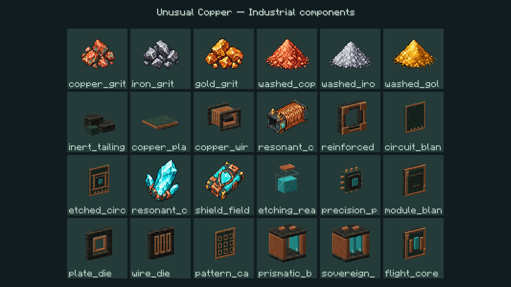
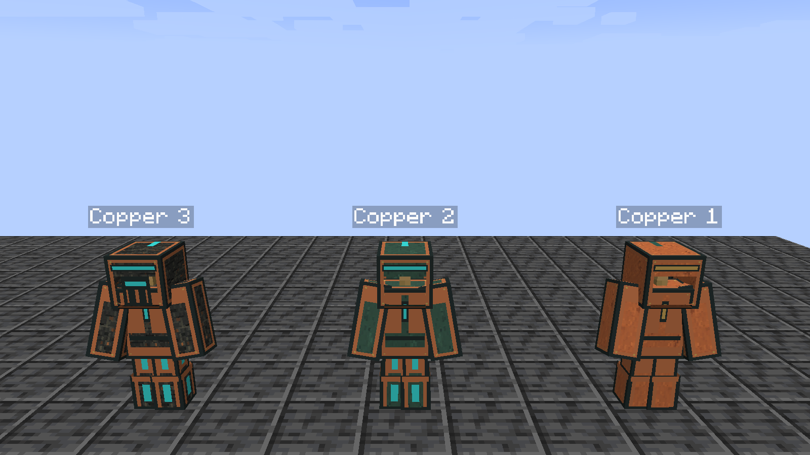

# Промышленное оформление — 0.20.9-alpha.1

Это художественный этап, **ещё не установленный** в пользовательский клиент/сервер. Установлена 0.20.8-alpha.1 с SSN Progressive 1.4.1. Полное завершение разработки отслеживается в [COMPLETION_TRACKER](COMPLETION_TRACKER.md).

## Устройства

| Машина | Форма и рабочий орган |
|---|---|
| Дробилка | Открытая приёмная горловина, два встречных зубчатых валка |
| Пресс | Две стойки и тяжёлая траверса, шток и опускающаяся матрица |
| Промывка | Стеклянная камера, реальный уровень воды, мешалка и пузырьки |
| Кристаллизатор | Подвесной огранённый кристалл между индукционными кольцами |
| Травитель | Низкая жидкостная ванна и движущаяся сканирующая перекладина |
| Сборщик | Девять контактных площадок и перемещающаяся сборочная головка |
| Насос | Камера жидкости, приводной вал и крыльчатка; прежняя аура источника сохранена |
| Резервуар | Стекло, отдельная шкала, реальные тип и количество жидкости |
| Контроллер | Панель с индикаторами, аппаратные клавиши и задняя стойка |
| Станция брони | Открытая подвеска и две зарядные направляющие |

Механизмы используют серверный `active`, плавно набирают/сбрасывают скорость и сохраняют фазу при остановке. Жидкость интерполируется отдельно: наружу передаются только тип и ограниченное количество; инвентари, capability/NBT предметов и химические данные не раскрываются. Вода учитывает обычный свет, лава сохраняет собственную яркость. Клиент не расходует энергию/жидкость и не выполняет обработку.

Исправлена общая ошибка материалов: `MultiBufferSource` может возвращать один и тот же builder для разных текстур. Материал теперь выбирается непосредственно перед записью примитива. Регрессионный JUnit воспроизводит чередование металла/свечения на общем приёмнике без Minecraft/GPU.

Модели, сфера и время полёта экстрактора не перерабатывались.

## Предметы и броня

22 промышленных детали, модульных картриджа и батарейных блока имеют собственную кубоидную геометрию. Для всех сохранены `.bbmodel`. Материалы общие с корпусами: авторская медь, патина, тёмный металл и аквамариновые вставки.

Дроблёное сырьё трёх металлов, три порошка, резонансный кристалл, катушка и щитовой модуль используют девять новых RGBA-спрайтов. Ещё один спрайт — эфирная матрица — подготовлен для незавершённого E7; её регистрация и рецепт **не считаются реализованными**. Оригиналы и точные запросы встроенного `image_gen`: [art/industrial/prompts.json](../art/industrial/prompts.json), [исходники](../art/industrial/sources/). Игровые копии — 64×64, nearest-neighbor, с сохранением alpha.

Для брони I–III нарисованы шесть собственных UV-слоёв 256×128 и 12 предметных моделей. Слой I — медь, II — патина с усилением, III — тёмный каркас с медными панелями. Различаются визоры, швы, колени и задняя батарейная панель. Ванильная железная текстура больше не используется. Геометрия надетой брони — стандартный humanoid Minecraft; новые UV не меняют характеристики, NBT, цены и модули.

## Воспроизведение и проверка

Для этого этапа используются отдельные генераторы, не запускающие старую генерацию переводов и рецептов:

```text
python tools/generate_industrial_assets.py
python tools/generate_component_models.py
python tools/generate_armor_art.py
python tools/import_industrial_sprites.py
python tools/check_visual_assets.py
```

Сохранённые материалы входят в репозиторий; для воспроизведения не требуется повторять image_gen или скачивать изображения. Проверяется 185 блоковых/предметных моделей, UV/текстуры/копланарные наложения, 23 старых и новых RGBA-спрайта, источники 44 новых предметных/машинных моделей и шесть слоёв брони. В legacy-генераторе убрано повторное присваивание blockstate моста SSN, терявшее шесть условий кабельных муфт.

По явному разрешению пользователя `gradlew runClient -PindustrialVisualClient` запускает только витрину в `run-industrial-visual/saves/cue-industrial-visual`, скопированную из служебного мира. Пользовательские клиент, сервер и сохранения не используются. Машины в витрине остановлены красным камнем и без ингредиентов; тестовый код задаёт демонстрационные рабочие позы. Кадры подтверждают рендер, **не** исполнение заказов, расход ресурсов или безопасность фабрики.

В свежем checkout сначала подготовьте копию любого **служебного тестового мира** (путь `path/to/test-world` заменяется существующим каталогом с `level.dat`):

```text
python tools/prepare_visual_world.py --source path/to/test-world
gradlew runClient -PindustrialVisualClient
```

Подготовщик только читает источник, не копирует файловые ссылки и не перезаписывает существующий мир витрины. Сам запуск клиента автоматически закрывается после кадров. В камерах используются настоящие animated sprites жидкостей из block atlas, включая цвет воды биома; бирюзовая текстура энергии не подменяет лаву.

Снято и просмотрено 11 кадров: покой, две фазы работы, вид сзади, ночь, два крупных плана, броня спереди/сзади, компоненты и экипировка. В последнем запуске нет сообщений о пропавших текстурах Unusual Copper. Отсутствующие необязательные SSN/Quark и тестовый `fixture_mining` не выдаются за проблемы release-ассетов.





Остаются: реальные игровые действия и соединения в полном модпаке, все повороты/шейдеры/водная сортировка, динамическая жидкостная логистика, FPS при 50–100 устройствах, GUI/HUD/звук и остальные требования E0–E9. Скриншоты витрины не закрывают эти пункты.
