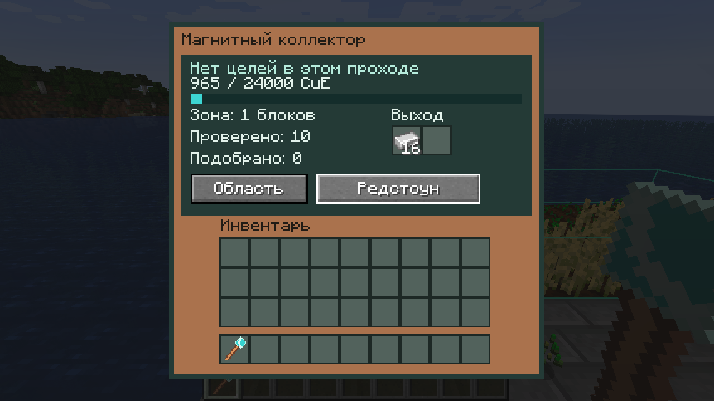

# Магнитный коллектор — 0.3.0-alpha.2

Ранняя машина M2 из раздела 16.1 GDD: подбирает существующие `ItemEntity` в выбранной области в собственные два выходных слота. Хранилище можно подключить снизу трубой или привязать жезлом. Предметного входа нет. CuE поступает через разрешённые энергетические грани; буфер 24 000.

## Работа

Выберите область жезлом так же, как у культиватора. Размер до 16³, радиус 32, права и загрузка чанков проверяются сервером. Раз в 20 тиков коллектор запрашивает волну: до 16 предметных кандидатов, до одного целого стака. Общая очередь резервирует не более 256 таких кандидатов на измерение за тик и рассматривает не более 128 запросов машин.

Индекс загруженных предметов обновляется событиями появления, удаления и смены секции. Он хранит слабые ссылки в секциях 16³. Область касается максимум восьми секций; за волну просматриваются максимум восемь секционных ключей и 16 записей, включая отвергнутые/устаревшие. Записи и начальная секция вращаются: плотная куча заблокированных предметов не скрывает следующие навсегда. Полный список сущностей мира или всей кучи не создаётся. Перед изменением дополнительно проверяется, что UUID всё ещё указывает на ту же сущность в серверном мире.

Начальная цена уточняет диапазон 30–100 из GDD:

```text
CuE = 30 + ceil(70 × clamp(расстояние от центра машины / 32, 0, 1))
```

Оплачивается один существующий стак целиком, независимо от числа предметов внутри. Компоненты 30 и 70 меняются через серверный конфиг. Перед действием проверяются место под весь результат и полная цена. В одном серверном вызове предмет с точным NBT помещается в собственные выходы, энергия списывается, исходная сущность удаляется. Если места или энергии нет, предмет остаётся на земле и оплата не происходит. Сбор не удаляет блоки, не производит предметы из рецепта и не изменяет чужие инвентари.

Не подбираются предметы с действующей задержкой, чужими UUID `Owner`/`Thrower`, за пределами области, в недоступном claim и неизвестные подклассы `ItemEntity`. Чужой `Thrower` пропускается и после окончания обычной задержки: текущая политика консервативнее общего подбора игроком. Модовые подклассы требуют отдельного адаптера. Redstone приостанавливает запросы и выполнение.

## Проверки

Вместе с ядром и культиватором проходят 41 обязательный GameTest. Шесть новых проверяют точный именованный стак/одну оплату/загрузку NBT, заполненный выход и неполную оплату, задержку/Owner/Thrower/границу зоны, лимиты индекса/общей очереди на 20 коллекторах с 40 сущностями, справедливый обход 40 задержанных предметов с обновлением индекса при перемещении и позднюю отмену появления предмета настоящим Forge listener. Отклонённая сущность не превращается в предмет в выходе, даже если её join-событие уже видел индекс. Восемь JUnit-тестов остаются зелёными.

На обычном dedicated server с настоящим OpenPAC 0.30.1 машина с чужим владельцем вне claim не смогла подобрать предмет внутри claim и сохранила энергию. Владелец подобрал восемь реальных слитков. Это дополнение проверок инвентаря и роста, а не приёмка всех партийных политик OpenPAC.

Настоящий клиент получил 16 слитков из удалённой сущности за 35 CuE при расстоянии 2: в меню синхронизированы выход и остаток 965/24 000. Русское меню проверено визуально; тестовый клиент завершился штатно. Счётчики показывают последний проход, включая отвергнутые записи секции, а не накопительный сбор.



Повторение: `gradlew.bat --no-daemon build runGameTestServer`. Для опционального профиля OpenPAC нужны свой JAR и изолированный сервер, как в [ITEM_TRANSPORT](ITEM_TRANSPORT.md); успех подтверждает `CuE OPENPAC COLLECTOR PASS`, а не только выход Gradle. Свидетельства: [выдержки логов](verification/magnetic-collector-2026-10-15.txt).

## Оставшиеся проверки

Профиль нагрузки ещё нужен: алгоритмические лимиты подтверждены функциональными тестами, но p95 MSPT на пользовательском модпаке пока не измерен. Индекс не сохраняет копию предметов и не восстанавливает выгруженные сущности самостоятельно.

Ещё предстоят штатные дисковые рестарты, выгрузки чанков и внезапный crash рядом с переносом entity → BlockEntity. Сохраняемый NBT в тесте подтверждает формат и отсутствие повторной выдачи в этом сценарии; межчанковая crash-атомарность остаётся D11. Рабочие эффекты, звук и полная проверка Forge 47.4.20 входят в дальнейший маршрут. UC-09 пока не закрыта.
