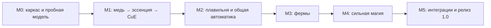

# Маршрут разработки Unusual Copper

> **Следующая ветка после 0.20.6:** [Industrial Expansion E0–E9](INDUSTRIAL_EXPANSION_ROADMAP.md). Единый [GDD](INDUSTRIAL_EXPANSION_GDD.md), [программируемая броня](PROGRAMMABLE_ARMOR.md) и [TDD](INDUSTRIAL_EXPANSION_TDD.md) описывают **предлагаемые**, пока не реализованные машины, автокрафт, модули и полёт. Исторический маршрут M0–M5 ниже остаётся основой приёмки 1.0 и не закрывается добавлением новых функций.

**Срез на 17 октября 2026:** актуальная версия — **0.20.6-alpha.1**, SSN Progressive — **1.4.0**. [Указатель текущих систем](INDEX.md), [изменения](../CHANGELOG.md), [манифест актуальной проверки](../releases/0.20.6-alpha.1.json). Для этой пары прошли 54 + 44 JUnit; GameTest-сценарии только скомпилированы. Цифры и игровые запуски ниже относятся к историческим этапам, а не к новой приёмке текущего JAR.

Дата планирования: **14 октября 2026 года**. Основание: [GDD/TDD v0.2](Unusual_Copper_GDD_TDD_v0.2.md) и [визуальный референс](references/visual-style.png).

Этот документ превращает концепт в порядок работ. Реализованы прототипы медной экономики, предметной автоматики, восьми основных машин и SSN Bridge; есть RU/EN, Blockbench-модели и первая категория JEI. В `0.12.0-alpha.1` добавлены энергетические приоритеты, разветвитель и монитор. Серверные, клиентские и OpenPAC-проверки подтверждают описанные сценарии; полная приёмка этапов ещё впереди. Свидетельства перечислены в документах конкретных систем и [плане проверок](TEST_PLAN.md). Этапы не закрываются только на основании существования кода; завершение определяется полными критериями приёмки.

Все UC-задачи со ссылками на GitHub и зависимостями: [BACKLOG](BACKLOG.md).

В `0.13.0-alpha.1` выполнен [визуальный проход](VISUALS.md): девять новых предметных спрайтов, обновлённый металл, муфты на фактических соединениях, прозрачные трубы с зарядом/направлением потока, уровни ячеек и рабочие движения аппаратов. Проверка экспорта на совпадающие плоскости и отдельный игровой визуальный профиль дополняют общие тесты; это не закрывает релизную матрицу M5.

## Порядок и границы

Художественная работа идёт рядом с программированием своего этапа: блокинг → игровой прототип → текстура → эффекты. Сначала подтвердить читаемость одной машины в Minecraft, затем собирать всё семейство. Высокая детализация референса не требует повторять каждый болт геометрией.

| Этап | Результат | Зависимость | Версионная цель |
|---|---|---|---|
| M0 | Запускаемый пустой мод и проверенный путь импорта модели | Нет | Каркас |
| M1 | Замкнутый по инфраструктуре, расходующий медь энергетический цикл | M0 | Внутренний alpha |
| M2 | Первая полезная фабрика: плавильня, трубы, управление, культиватор | M1 | MVP, alpha 0.1 |
| M3 | Животные, добыча мобов и безопасная лесозаготовка | M2 | alpha 0.2 |
| M4 | Охрана, зелья и зачарование | M3, общие контракты M2 | feature complete beta |
| M5 | Проверенная совместимость, оформление и стабильность | M0–M4 | 1.0.0 |

Названия alpha/beta — план, а не уже опубликованные релизы. Разработку конкретных устройств M4 можно вести после M2 независимо от ферм; приёмка общей beta требует и M3, и M4.

## M0 — Репозиторий, Forge-каркас и пробная модель

**Задачи:** UC-01, UC-02.

- Зафиксировать точную версию Forge 47.x под целевой сервер, JDK 17 и зависимости; взять официальный MDK, заменить `examplemod` на `unusualcopper`.
- Добавить регистрационные точки, клиентскую и серверную части, базовые конфиги, RU/EN и datagen.
- Проверить `build`, `runClient`, `runServer`, `runData`; после появления wrapper добавить CI сборки и GameTests. Принятие Minecraft EULA выполняет владелец тестового сервера.
- Создать в Blockbench один статичный тестовый корпус с медью, тёмной рамой и стеклом; проверить JSON, инвентарь, освещение и render layers в игре.
- Принять решения D01–D03 и D07 из [журнала решений](DECISIONS.md).

**Готово, когда:** чистый checkout воспроизводимо собирается на JDK 17, клиент показывает тестовый блок, dedicated server запускается без загрузки клиентских классов, модель не имеет ошибок ресурсов. Тестовая модель не объявляется финальным ассетом.

## M1 — Первый стак меди

**Задачи:** UC-03, UC-04, UC-05.

1. Алмазная солнечная линза, входные рецепты, эссенция и солнечный насытитель. Обрабатывать ночь/дождь/грозу/закрытое небо; два выходных слота, безопасная частичная партия и долговечность линзы.
2. Расщепитель: 500 CuE за эссенцию, буфер 50 000, до четырёх единиц за тик, расход только при наличии места.
3. Собственная CuE capability; базовый провод 256 CuE/тик, ячейка I 250 000 CuE. Пересборка графа по событиям, сохранение количества энергии, ограничение узких участков и справедливое распределение.
4. Минимальные GUI, redstone-режимы, статусы, сохранение энергии/предметов/прогресса; модели насытителя, расщепителя, провода и ячейки.

**Готово, когда:** 64 слитка → 128 эссенций → 64 000 CuE; сырая медь даёт вдвое меньше. Энергию нельзя получить через FE-вход. После десяти последовательных сохранений/перезапусков, разрывов сети и выгрузок нет потерь/дюпов. Выполнены тесты M1 в [плане проверок](TEST_PLAN.md).

**Важно:** буфер расщепителя меньше 64 000 CuE, поэтому тест полного стака обязан реально отводить энергию в ячейку. Не увеличивать буфер только ради демонстрации.

В `0.11.0-alpha.1` добавлены [энергетические классы II/III](ENERGY_TIERS.md): провода 1 024/4 096 CuE за тик и ячейки 2/16 млн CuE, рецепты, модели и проверки узких участков. В `0.12.0-alpha.1` добавлены [монитор, разветвитель с лимитами и приоритеты потребителей](ENERGY_CONTROL.md) из раздела 6.2 GDD. Для завершения энергетической инфраструктуры 1.0 ещё требуются профиль крупных сетей, полный маршрут в модпаке и аудит сохранений.

## M2 — Первая полезная фабрика и общая автоматика

**Задачи:** UC-06, UC-07, UC-08, UC-09.

Порядок: плавильня → стандартное хранение/трубы → настройки областей → культиватор/коллектор.

- Плавильня: `RecipeManager`, разрешённые руды/сырьё, время `max(1, ceil(cookingTime / 10))`, 240 CuE за операцию, сохранённый оплаченный прогресс, два выхода, корректный `/reload`.
- `StorageEndpoint` и `IItemHandler`: симуляция, реальная повторная проверка, сохранение остатка при отказе, точный NBT. Затем предметные трубы с фильтрами/приоритетом/лимитом операций.
- Жезл, селектор шести граней, ограниченные зоны, ownership, redstone, безопасные серверные пакеты, причины остановки. Общая очередь сканирования и интерфейс защиты территорий появляются до опасных машин M3.
- Культиватор: не более восьми проверок растений за 20 тиков, 140 CuE за успешный рост; без скрытого автоурожая. Магнитный коллектор — дополнительная машина, её цена фиксируется отдельным решением.
- Игровые модели плавильни, предметных труб, культиватора и коллектора; статичные корпуса сначала, редкие рабочие эффекты после проверки механики.

**Готово, когда:** 64 типовых руды переплавляются за 1 280 активных тиков за 15 360 CuE; заполненный выход и отключение энергии безопасно ставят процесс на паузу. Вся демонстрационная фабрика работает с сундуками без SSN. Недопустимые пакеты/зоны отклоняются. M2 — первый играбельный MVP.

## M3 — Фермы

**Задачи:** UC-10, UC-11, UC-12. Порядок: пастырь → жнец → арборист.

Пастырь реализован и проверен отдельным отчётом. У Жнеца реализован прототип реальных убийств/дропа, порогов, аварийного буфера, меню правил, подготовки со сжатием в руну и дуг действительной добычи: [MOB_REAPER](MOB_REAPER.md). Точные популяционные подписки и фильтры описаны в [MOB_POPULATIONS](MOB_POPULATIONS.md). [Прототип Арбориста](ARBORIST.md) добавляет посадочные точки, семь адаптеров деревьев, резерв топора/саженцев, реальные события Forge, поэтапную рубку и пересадку. Проверены восстановление задания из файла мира, смена владельца привата и ванильная защита спавна. Мангровые/модовые деревья, совместимость с полной сборкой и полная приёмка ещё впереди; критерии M3 ниже сохраняются полностью.

- Пастырь: корректные возрастные API, 400 CuE за ускоренную особь, волна каждые 200 тиков, ускорение 2 400 тиков; не изменять размножение.
- Жнец: фильтры целей, «начать > N / оставить M», штатный серверный урон/дроп, 1 500 CuE на цель, до одной цели за 20 тиков, аварийный буфер дропа.
- Арборист: размеченные посадочные точки, ограниченный детектор дерева до 256 блоков, разрешения, резерв саженцев, поэтапная рубка до четырёх брёвен/тик, пересадка того же вида. Подозрительные постройки пропускать.
- Проверить реальные claims-моды целевого сервера. При отсутствии подтверждённого адаптера не заявлять поддержку его защиты; политика по умолчанию описана в D06.
- Три отличимых силуэта и дешёвые событийные эффекты: волна, руна, спираль.

**Готово, когда:** пройдены проверки целей, дропа, последнего свободного места, перезапусков и чужих территорий; дом из брёвен не становится деревом. Жнец/арборист не входят в стабильный релиз с воспроизводимыми потерями или обходом защиты.

## M4 — Сильная магия

**Задачи:** UC-13, UC-14, UC-15.

В `0.7.0-alpha.1` реализован [прототип Медного часового](COPPER_SENTINEL.md): урон 10 HP через обычную защиту, настоящая видимость, оплата выстрела/поддержания, перезарядка, физическое улучшение 24→64, лимит на чанк и координация целей. В `0.8.0-alpha.1` добавлен [Эфирный автоклав](AETHERIC_BREWER.md): реальные рецепты зелий, поэтапное расходование, обычное физическое хранилище, общий запас, приоритет и сохраняемые промежуточные продукты. В `0.9.0-alpha.1` добавлен [Резонатор зачарований](ENCHANTMENT_RESONATOR.md): реальные совместимые чары, бесплатный предпросмотр, одноразовое подтверждение, 64 лазурита, XP points и CuE. Проверены клиент, отказ XP-событий, отзыв привата и обычное сохранение. Нативный SSN Bridge проверен в M5; полная матрица рецептов/производительности, аварийная атомарность D11 и приёмка M4 остаются открытыми.

- Страж: допустимые цели, line of sight, 10 HP до защиты, 2 500 CuE за выстрел, 1 CuE/тик поддержания; базовый радиус 24 и платный фокус до 64 реализованы, окончательный баланс проверить. Парящий кристалл — клиентский BER.
- Автоклав: бутылки и реальные реагенты, последовательный план стадий, внутренние промежуточные продукты, режим поддержания запаса, корректные паузы/reload. Вода не требует физического снабжения.
- Зачарователь: только применимые/совместимые чары до реального максимума, 64 лазурита, реальные XP points, серверная транзакция и явное подтверждение цены игроком в GUI.
- Прототипы GUI до финальных текстур; модели и рабочие эффекты трёх машин. GeckoLib добавлять только после решения D03 и проверки нагрузки.

**Готово, когда:** все восемь основных машин GDD работают; XP, ресурсы и результат не расходятся при повторных кликах, нехватке ингредиентов и перезапуске. Две машины не получают один и тот же последний реагент. Произвольные модовые зелья/деревья/чары поддерживаются только проверенными адаптерами.

## M5 — Интеграция, художественная полировка и 1.0

**Задачи:** UC-16, UC-17, UC-18.

В `0.9.1-alpha.1` начата общая основа SSN Bridge: единая фабрика endpoint и [поэтапный индекс больших физических инвентарей](STORAGE_INDEX.md) с реальными dirty-ревизиями. Нативный [SSN Bridge](SSN_BRIDGE.md) проверен с реальным SSN 1.13.2, Progressive 1.2.4 и OpenPAC 0.30.1; остальные критерии релиза M5 открыты.

- Проверить точные версии SSN и SSN Progressive, подключить серверный адаптер; базовая фабрика продолжает работать без них. Отдельно проверить одинаковые ID предметов с разным NBT.
- Первая необязательная интеграция JEI 15.21.0.138 добавляет отображение настоящих солнечных рецептов (1/2 эссенции), линзу как катализатор и подсказки о CuE. Подтверждено тремя реальными клиентскими smoke-прогонами: JEI отдельно; JEI+SSN 1.13.2+Progressive 1.2.4; та же связка с OpenPAC 0.30.1. Четыре datapack-рецепта, верный катализатор, окно JEI, PNG и штатный выход проверены; отсутствие JEI подтверждено 117/117 Forge GameTests. RU/EN других интерфейсов, рецепты прогрессии, внутриигровое руководство, достижения и понятные сообщения остановки остаются в работе. [Ручной тест клиента](TEST_CLIENT.md).
- Согласовать полный набор моделей/текстур/звуков; проверить прозрачность, свет, отключённые частицы, ресурс-паки и 50–100 видимых машин.
- Пройти T01–T36 на чистом Forge, dedicated server и целевом модпаке. Профилировать 50–100 машин и около 1 000 узлов; сохранить оборудование, baseline, p95 MSPT, стоимость мода и ограничения.
- Провести игровой баланс меди/минуту. Числа GDD — начальные настройки, изменения оформить явно.
- Зафиксировать лицензии/авторство, проверить установку production jar, сохранения и обновление мира; подготовить changelog, совместимые версии и известные ограничения.

**Готово, когда:** вся релизная матрица имеет записи о результатах, нет открытых блокирующих дюпов/crash/ошибок защиты, соблюдён утверждённый бюджет производительности, опубликован проверенный 1.0.0 с инструкцией установки.

## Текущий следующий шаг (после 0.20.6)

**E0 → E1:** зафиксировать API, базовые тесты, миграции и баланс, затем реализовать **резонансную дробилку** как первый вертикальный срез: существующий экстрактор → реальные трубы → дробилка → физический выход, с точным расходом CuE, /reload и сохранениями. [Задачи IE-00–IE-12 и критерии](INDUSTRIAL_EXPANSION_ROADMAP.md). Не добавлять вторую шахту, починятор или автокрафт SSN Progressive повторно.

## Исторический старт проекта (M0–M2)

1. UC-01: Forge MDK, JDK 17, клиент, сервер и сборка.
2. UC-02: одна пробная Blockbench-модель в реальном освещении Minecraft.
3. UC-03: линза и солнечный насытитель на простых временных текстурах.
4. UC-04/UC-05: расщепитель, CuE capability, провод и ячейка; проверить арифметику и рестарт.
5. UC-06: плавильня и первая демонстрация полезного потребления энергии.

## Позже 1.0

FE-out с потерями, межпространственная передача, chunk loading, универсальная поддержка динамических деревьев/модовых зелий, продвинутые визуальные каналы труб, новые промышленные машины, программируемая броня и мультиблоки не блокируют первоначальный релиз. FE-in и бесконечная регенерация меди противоречат основной экономике.

## Завершение отдельной задачи

Задача закрывается после реализации, применимых тестов, проверки клиента/сервера, сохранений и обновления документации. Для художественной задачи нужны `.bbmodel`, PNG/экспорт и скриншоты в игре. Для проверки производительности — измерения, а не впечатление. Milestone закрывается только после выполнения общего критерия готовности.
